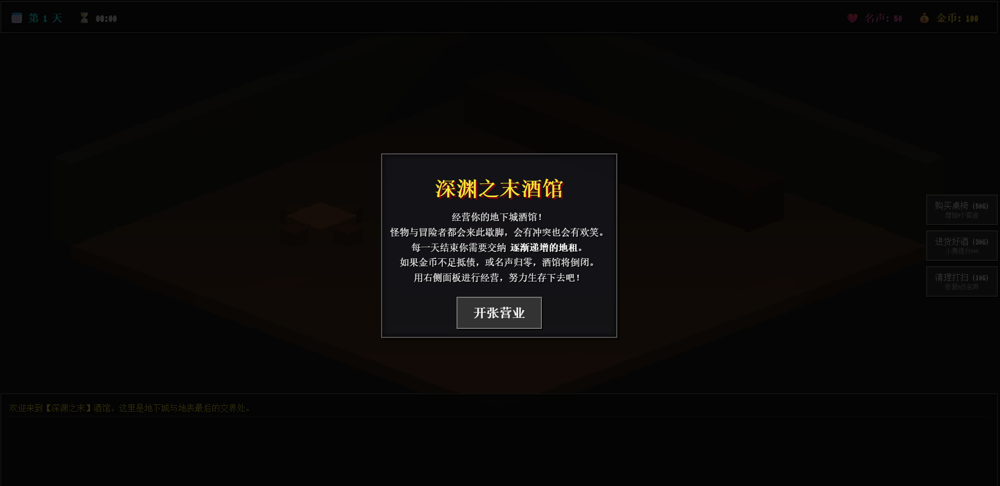
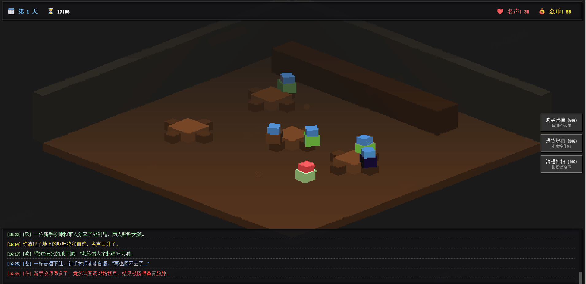

# 🍺 深渊之末酒馆 | Tavern at the End of the Abyss

[](https://CNSleepybear.github.io/tavern-at-the-end/)
[](https://threejs.org/)
[]()
[](LICENSE)

一款基于 **Three.js** 开发的**地下城肉鸽酒馆经营**游戏，融合**像素风3D视觉**、**随机叙事生成**与**生存经营压力**，纯前端实现，开箱即玩。

> *"这里是地下城与地表最后的交界处。怪物与冒险者在此歇脚，有酸甜苦辣，也有悲欢离别。每天结束时，地下城收税官会准时敲门。"*

---




## ✨ 功能特性

### 🎮 核心经营系统
- **体素像素风3D**：低分辨率渲染 + CSS像素化拉伸，纯正复古游戏质感
- **正交投影视角**：固定等轴视角，专注经营策略而非相机操控
- **程序化生成功能**：所有3D模型、材质、音效均通过代码实时生成，零外部资源依赖
- **动态顾客系统**：冒险者、怪物、神秘人三类角色随机登场，各有行为逻辑

### 🍻 深度酒馆运营
- **双资源管理**：金币（经营资本）与名声（客流量）的动态平衡
- **每日递增租金**：第1天50金起，每天租金增长20金，生存压力逐步升级
- **扩建系统**：最多7张桌子（初始2张+购买5张），每张增加4个客座
- **进货策略**：投资30金进货好酒，触发"极品好酒供应中"Buff，小费收入提升50%
- **危机处理**：花费10金清理打扫，可恢复5点因斗殴或事件损失的名声

### 📖  procedurally generated叙事
- **酸甜苦辣故事引擎**：基于角色类型组合随机生成剧情片段
- **情感事件系统**：
  - 🟢 **欢乐时刻**：分享战利品、滑稽舞蹈、慷慨小费（金币+2，名声+1）
  - 🔵 **悲伤故事**：临终独酌、失散战友、未寄出的信（氛围沉浸）
  - 🔴 **酒馆斗殴**：作弊争执、眼神冲突、信仰械斗（名声-5，视觉特效）
- **角色化学反应**：同桌顾客可能互动，触发冲突或友谊事件

### 🎭 生存挑战机制
- **客流量算法**：名声越高，顾客刷新间隔越短（最快1秒间隔）
- **容量管理**：座位满员时新顾客会愤怒离去（💢），损失潜在收入
- **神秘人设定**：黑市商人、流浪诗人、深渊凝视者，支付高额小费（基础+20金）
- **动态时间流逝**：现实中60秒=游戏内1天（08:00-24:00），紧迫感实时可见

---

## 🚀 在线体验
**🔗 [立即体验 深渊之末酒馆](https://CNSleepybear.github.io/tavern-at-the-end/)**

### 🕹️ 操作指南

纯鼠标操作，零学习成本：

| 按钮 | 功能 | 说明 |
| :--- | :--- | :--- |
| **购买桌椅 (50G)** | 扩张经营 | 增加4个客座，上限7桌 |
| **进货好酒 (30G)** | 提升品质 | 本日内小费+50%，吸引神秘人 |
| **清理打扫 (10G)** | 危机公关 | 恢复5点名声，应对斗殴后果 |

### 💡 生存策略提示
1. **前期策略**：优先购买桌椅扩大容量，接待更多顾客
2. **Buff时机**：在名声较高、客流量大时进货，最大化好酒收益
3. **名声维护**：斗殴会快速降低名声，必要时立即清理止损
4. **租金准备**：每天结束自动扣租（50→70→90...），务必预留资金

---

## 🛠️ 技术栈
- **Three.js r128**：WebGL 3D渲染，程序化生成体素角色与场景
- **程序化材质**：Canvas API动态生成木质、石质纹理，FlatShading强化LowPoly感
- **Web Audio API**：动态音效合成（预留接口，当前版本静音模式）
- **CSS像素化**：`image-rendering: pixelated`实现低分辨率画面的清晰像素拉伸
- **VT323字体**：Google Fonts复古像素字体，强化终端机质感
- **LocalStorage**：本地高分记录与状态持久化（后续版本实现）

---

## 📦 本地运行

### 📋 环境要求
- 现代浏览器（Chrome 80+ / Firefox 78+ / Edge 80+ / Safari 13+）
- 支持 WebGL 与 ES6 Modules
- 建议分辨率：1920×1080 或更高

### ⚡ 快速开始

```bash
# 克隆仓库
git clone https://github.com/CNSleepybear/tavern-at-the-end.git
cd tavern-at-the-end

# 启动本地服务器（必需用于ES6模块加载）
python -m http.server 8000
# 或
npx http-server -p 8000
# 或 VS Code Live Server

# 浏览器访问
open http://localhost:8000
```

> **注意**：直接打开 `index.html` 可能因CORS策略导致Three.js模块加载失败，请使用本地服务器。

---

## 📁 项目结构

```
tavern-at-the-end/
├── index.html          # 游戏主文件（完整自包含：CSS + JS + HTML）
├── README.md           # 项目说明（本文件）
├── LICENSE             # MIT 许可证
└── screenshot.png      # 游戏截图（可选，用于社交预览）
```

> **架构特点**：单文件应用（Single-File Application），所有游戏逻辑、样式、3D资源均内联于 `index.html`，便于快速部署与分享。

---

## 🎨 游戏机制详解

### 经济模型
| 项目 | 数值 | 机制 |
| :--- | :--- | :--- |
| 初始资金 | 100金 | Day 1起始资本 |
| 基础租金 | 50金 | Day 1日终扣除 |
| 租金增长 | +20金/天 | 线性递增，生存压力曲线 |
| 基础消费 | 5-15金 | 普通顾客随机支付 |
| 神秘人加成 | +20金 | 神秘人类型固定加成 |
| 好酒倍率 | 1.5x | 当日所有收入系数 |

### 顾客生成算法
```javascript
// 伪代码逻辑
if (random < 0.45)      → 冒险者（蓝色系，基础消费）
else if (random < 0.90) → 怪物（红色系，基础消费）
else                     → 神秘人（紫色系，高消费）
// 当 buffDrink === true 时，神秘人概率从10%提升至20%
```

### 事件触发概率（每帧0.5%）
- **悲伤故事**：30%概率，纯叙事，增强沉浸感
- **欢乐时刻**：30%概率，金币+2，名声+1
- **冲突斗殴**：20%概率，需同桌存在另一顾客，名声-5，触发物理抖动动画
- **无事发生**：20%概率

---

## 🧩 技术亮点

### 1. 程序化3D资产
无需建模软件，所有角色、桌椅、建筑均通过 `THREE.BoxGeometry` 组合与 `MeshStandardMaterial` 动态配色生成：
- **顾客**：Body(1×1.2×1) + Head(0.8×0.8×0.8)，颜色编码类别
- **桌椅**：BoxGeometry实例化，FlatShading材质强化像素感
- **酒馆环境**：地板(24×1×24) + 墙体 + 吧台，经典等轴布局

### 2. 正交投影视觉
```javascript
const camera = new THREE.OrthographicCamera(-d*aspect, d*aspect, d, -d, 1, 1000);
camera.position.set(20, 20, 20); // 等轴视角
camera.lookAt(0, 0, 0);
```
摒弃透视失真，呈现经典《暗黑破坏神》《模拟城市》式策略游戏视角。

### 3. 低分辨率渲染管线
- **内部渲染尺寸**：400×300 像素
- **CSS拉伸**：100vw × 100vh，配合 `image-rendering: pixelated`
- **视觉效果**：原生像素风，无需后处理着色器

### 4. 叙事生成系统
基于模板字符串的角色替换算法：
```javascript
let msg = randItem(STORIES.joy)
  .replace('[角色1]', this.name)
  .replace('[角色2]', target ? target.name : '某人');
```
简单高效，支持无限扩展故事模板。

---

## 📝 开发备忘

### v1.0 当前版本
- ✅ 核心经营循环：顾客生成 → 入座 → 消费 → 事件 → 离开 → 日终结算
- ✅ 三套经济操作：买桌、进货、清洁
- ✅ 程序化生成了20+种叙事变体
- ✅ 体素像素风视觉系统
- ✅ 租金递增生存压力机制

### 路线图 (Roadmap)
- 🔄 **音效系统**：Web Audio API程序化生成8-bit音效（开门、倒酒、金币、斗殴）
- 🔄 **高级顾客AI**：排队机制、吧台站立饮酒、VIP包间逻辑
- 🔄 **道具与技能**：玩家可手动干预的"调解冲突"、"免费酒水"等主动技能
- 🔄 **多结局系统**：根据经营风格（黑心资本家 vs 慈善酒馆老板）触发的不同结局文本
- 🔄 **移动端适配**：触控优化与虚拟按钮

---

## 🤝 贡献指南

欢迎提交 Issue 与 PR！推荐贡献方向：
- 🎭 新增故事语料（STORIES对象扩展）
- 🧩 新顾客类型（如"流亡王子"、"退休龙"）
- 🎨 新场景装饰（吊灯、地毯、壁炉程序化生成）
- 🌐 多语言支持（中文/英文叙事切换）
- 📱 移动端虚拟摇杆与触控优化

---

## 📄 许可证

**MIT License** - 查看 [LICENSE](LICENSE) 文件获取详情

> 注：游戏概念与代码均为原创，字体使用开源VT323（SIL Open Font License）。

---

## 🙏 致谢

- **Three.js**：强大的WebGL 3D渲染库
- **VT323 Font**：由 Peter Sullivan 设计的复古终端字体
- **RimWorld/Dwarf Fortress**：复杂叙事生成与情感模拟的灵感来源
- **Moonlighter**：地下城+经营双线玩法的结构参考

---

⭐ **如果觉得这个酒馆值得一杯好酒，欢迎点个 Star，让更多冒险者发现这个地下城角落。**

*致所有未曾说出口的告别，与那些发生在深夜酒馆的故事。*
